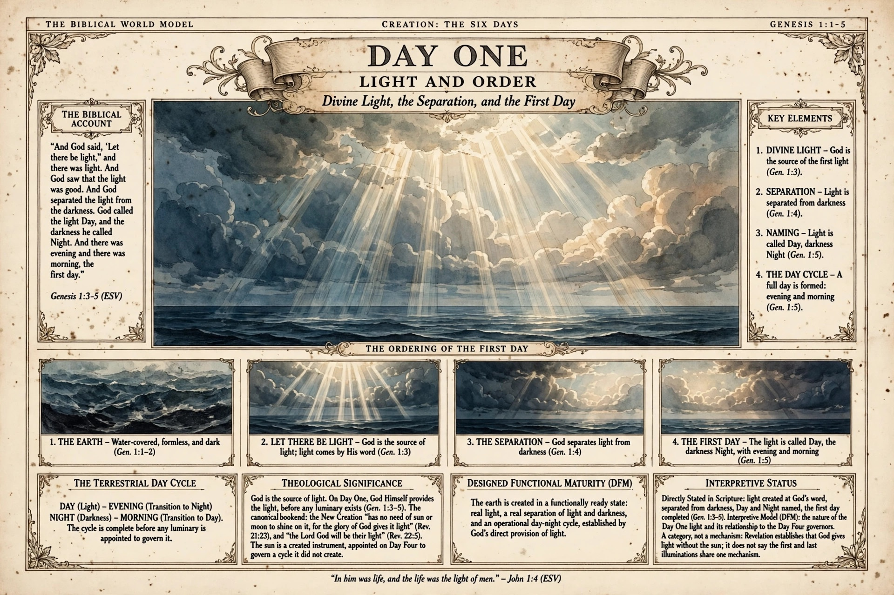
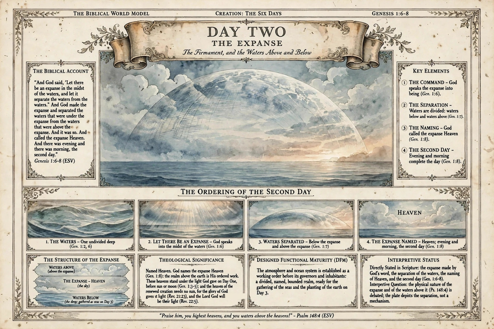
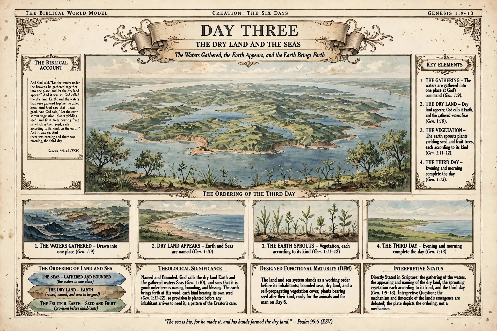

# The Creation Day Plates

Production of the atlas restarted on 13 November 2026 in its ruled format: a stand-alone landscape plate for each day of creation, under the header *Creation: The Six Days*, produced to the book's adopted plate style guide at the 12 x 9 in landscape trim, with no plate numbers on the artwork. Each plate carries the biblical account, the day's key elements, its theological significance, a Designed Functional Maturity panel, and an interpretive status panel that says plainly what Scripture states directly and what is model or hypothesis.

The first day plates, in an earlier portrait concept format, are kept on the [First Concepts (Archived)](first-concepts.md) page.

## Landscape candidate - Day 1: Light and Order

*Landscape candidate (record [BWM-IL-006](https://github.com/jdlongmire/biblical-worldmodel/blob/main/bwm-illustrated/illustrated-plates/006-day-1-light-and-order-landscape.md)) - Genesis 1:1-5.*

The first candidate plate in the ruled landscape format, produced under the adopted plate style guide. It treats the same day as Plate I above, recomposed as a landscape page: the account, the ordering strip, the terrestrial day cycle, and, at the author's direction, the theological arc of the light itself. God is the source of the first light, before any luminary exists; the sun is a created instrument, appointed on Day Four to govern a cycle it did not create; and the pattern closes at the end of Scripture, where the New Creation has no need of sun or moon, "for the glory of God gives it light" (Rev. 21:23), and "the Lord God will be their light" (Rev. 22:5). The plate's status panel keeps the distinction the author's own writing keeps: Revelation establishes the category, not a shared mechanism. No plate number appears on it, per the author's ruling. One word in its theological panel was misspelled in the generation and was repaired before filing; the repair is disclosed in full in the plate's record.

> "In him was life, and the life was the light of men." - John 1:4 (ESV)

## Landscape candidate - Day 2: The Expanse

*Landscape candidate (record [BWM-IL-008](https://github.com/jdlongmire/biblical-worldmodel/blob/main/bwm-illustrated/illustrated-plates/008-day-2-the-expanse-landscape.md)) - Genesis 1:6-8.*

The second plate of the production line, on the Day One pattern: the account of the expanse, its key elements, the ordering of the second day, the structure of the expanse (waters above, Heaven, waters below), a Designed Functional Maturity panel, and an interpretive status panel. The theological panel carries the light arc forward: these heavens stand under the light God gave on Day One, before sun or moon, and the heaven of the renewed creation needs no sun (Rev. 21:23; 22:5). One line in its theological panel was garbled in the generation and was repaired from the preceding generation's rendering of the same line; an earlier repair attempt missed and was itself corrected, and the full history is disclosed in the plate's record.

> "Praise him, you highest heavens, and you waters above the heavens!" - Psalm 148:4 (ESV)

## Landscape candidate - Day 3: The Dry Land and the Seas

*Landscape candidate (record [BWM-IL-009](https://github.com/jdlongmire/biblical-worldmodel/blob/main/bwm-illustrated/illustrated-plates/009-day-3-the-dry-land-and-seas-landscape.md)) - Genesis 1:9-13.*

The third plate of the production line, on the Day One pattern: the waters gathered into one place, the dry land appearing and named Earth, the gathered waters named Seas, and the earth sprouting vegetation, each kind bearing its own seed. The central view follows the text's own geography, at the author's direction: one single Pangea-type landmass ringed by the gathered sea, carrying large freshwater seas and broad lakes. This plate is a disclosed hybrid, built at the author's direction after six generations produced no single flawless render: the plate body is the first generation, whose landmass and compartments were clean as rendered; its account column interior is a later generation's word-perfect rendering, transplanted in native pixels; and the running header's reference was completed with the header's own digit. The full construction history is disclosed in the plate's record.

> "The sea is his, for he made it, and his hands formed the dry land." - Psalm 95:5 (ESV)

!!! note "Status of these plates"
    Concept candidates at web resolution, with review gates pending; not print-ready. The Day One plate is the author's approved style benchmark for the production line. Lettering defects found in generation were repaired from plate-family letterforms, or, for Day Three, by the disclosed hybrid construction described above; all repairs and construction steps are disclosed in full in the plates' records.

