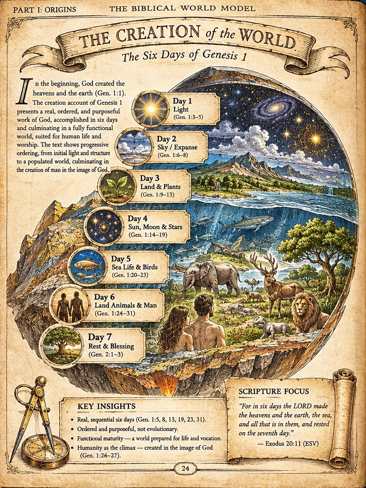
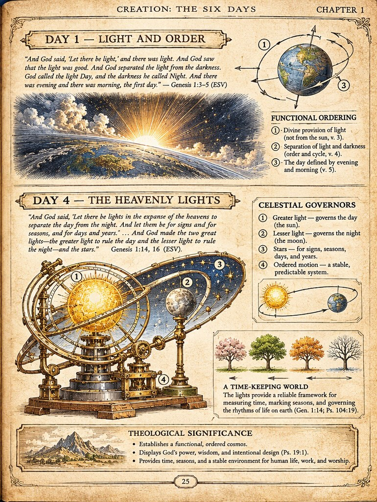

# Spread 001 - Creation: The Six Days of Genesis 1

Genesis begins with God creating the heavens and the earth (Genesis 1:1). The account unfolds as a sequence of divine commands, distinctions, and provisions, and culminates in God's rest on the seventh day (Genesis 2:1-3). This spread makes that sequence visible: an overview plate carrying all seven days, then a companion plate that slows down at the two days the whole structure turns on.

*Plate BWM-IL-001 - The Creation of the World (book page 24). Concept plate; see the status note at the foot of this page.*

## The seven days

1. **Day 1** - Light (Gen. 1:3-5)
2. **Day 2** - Sky / Expanse (Gen. 1:6-8)
3. **Day 3** - Land and Plants (Gen. 1:9-13)
4. **Day 4** - Sun, Moon and Stars (Gen. 1:14-19)
5. **Day 5** - Sea Life and Birds (Gen. 1:20-23)
6. **Day 6** - Land Animals and Man (Gen. 1:24-31)
7. **Day 7** - Rest and Blessing (Gen. 2:1-3)

Key insights, as lettered on the plate: the six days are real and sequential; the work is ordered and purposeful; the world is made with functional maturity, prepared for life and vocation; and humanity is the climax, created in the image of God (Gen. 1:26-27).

> Scripture focus: "For in six days the LORD made the heavens and the earth, the sea, and all that is in them, and rested on the seventh day." - Exodus 20:11 (ESV)

*Plate BWM-IL-002 - Day 1 and Day 4 (book page 25). The armillary device is artistic symbolism for calendrical governance, not an instrument of the creation week.*

## Day 1 - Light and Order (Genesis 1:3-5)

God speaks light into being - "Let there be light" - before any luminary exists to carry it. The plate's functional ordering:

1. Divine provision of light (not from the sun, v. 3).
2. Separation of light and darkness - order and cycle (v. 4).
3. The day defined by evening and morning (v. 5).

## Day 4 - The Heavenly Lights (Genesis 1:14-19)

On the fourth day the lights are placed in the expanse and appointed to their work. The plate's celestial governors:

1. The greater light governs the day (the sun).
2. The lesser light governs the night (the moon).
3. The stars serve for signs, seasons, days, and years.
4. Their ordered motion makes a stable, predictable system.

The lights provide a reliable framework for measuring time, marking seasons, and governing the rhythms of life on earth (Gen. 1:14; Ps. 104:19). The plate's theological significance: a functional, ordered cosmos that displays God's power, wisdom, and intentional design (Ps. 19:1), and gives humanity time, seasons, and a stable environment for life, work, and worship.

## Why Day 1 and Day 4 belong together

The pairing is the point of the spread. Light is *provided* on Day 1 and its governors are *appointed* on Day 4; the sequence distinguishes the gift from the instruments later assigned to rule it. Within the Biblical WorldModel, **functional maturity** - a world created already working, rather than assembled by slow accretion - is the interpretive proposal that reads this sequence as deliberate. That proposal is labelled as interpretation in the book's editorial record, not presented as something the text states in so many words. Proposed mechanisms for the light of Day 1 are hypotheses, and are marked as such wherever they appear.

## Go deeper - the day plates

Three days of this spread also have their own stand-alone plates, with fuller panels and an interpretive status panel on each: Day 1 (Plate I), Day 4 (Plate IV), and Day 6 (Plate VI). See [The Creation Day Plates](creation-day-plates.md).

!!! note "Status of this spread"
    Both plates are concept prototypes. The text lettered into them is artwork, not verified typesetting; the copies shown here are web-resolution, not print masters. Scripture wording, references, and claims are checked against the book's editorial gates before the spread is treated as final. The record for each plate - provenance, dimensions, claim status, and gate state - is filed openly at [BWM-IL-001](https://github.com/jdlongmire/biblical-worldmodel/blob/main/bwm-illustrated/illustrated-plates/001-creation-of-the-world.md) and [BWM-IL-002](https://github.com/jdlongmire/biblical-worldmodel/blob/main/bwm-illustrated/illustrated-plates/002-day-1-and-day-4.md).
