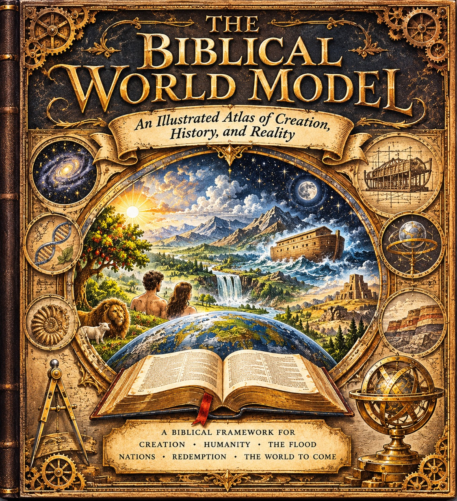
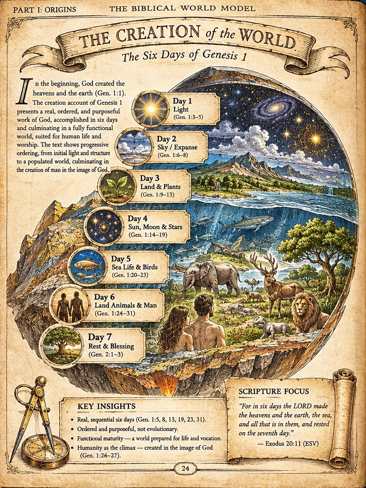
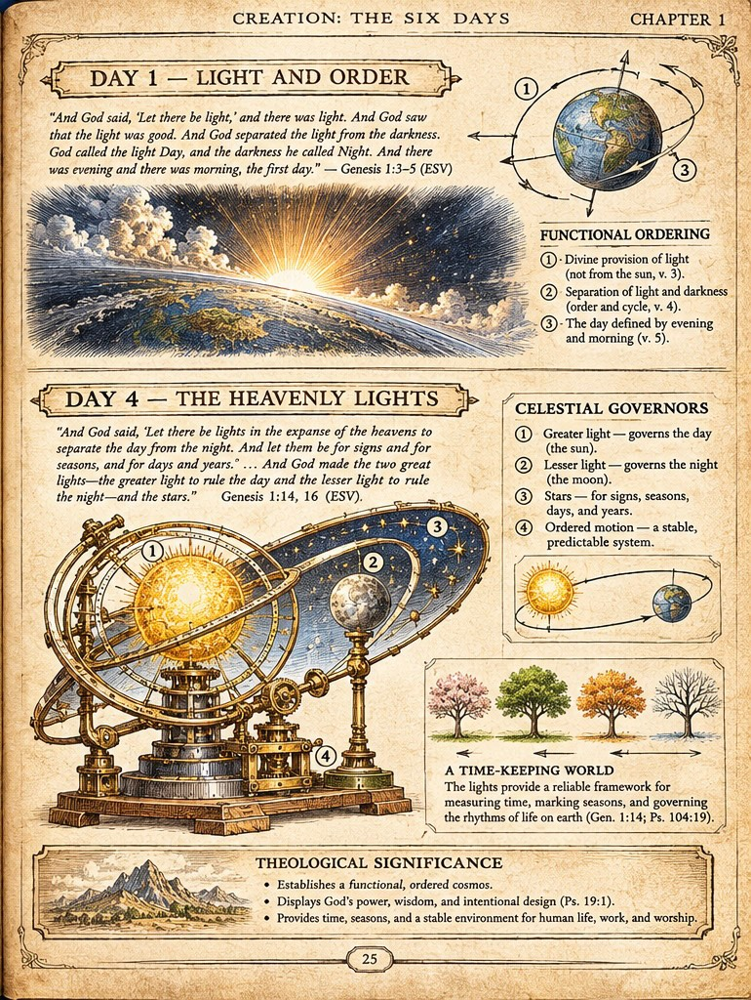
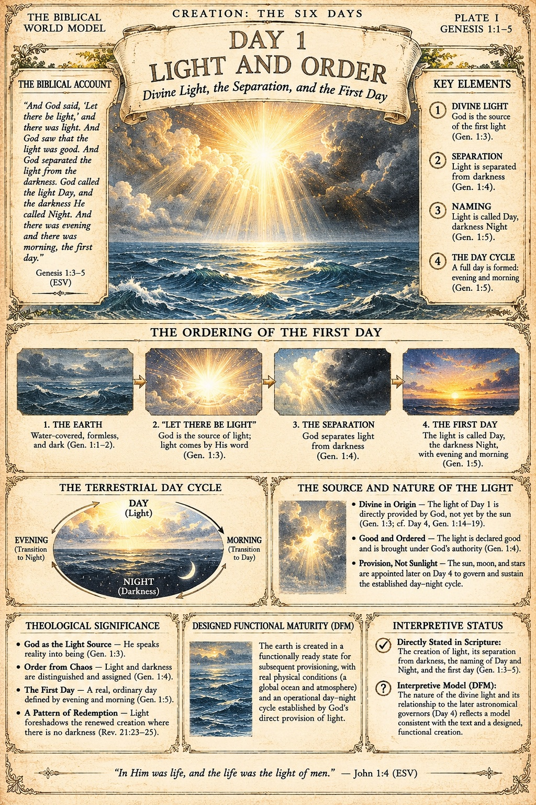
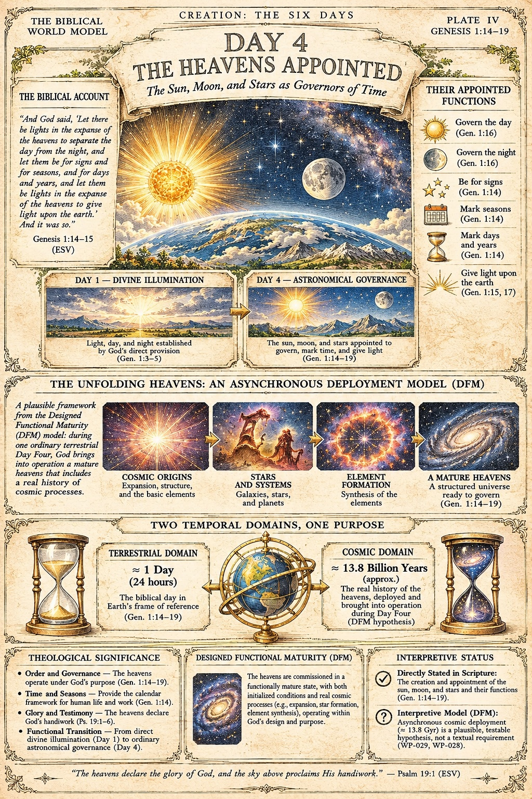
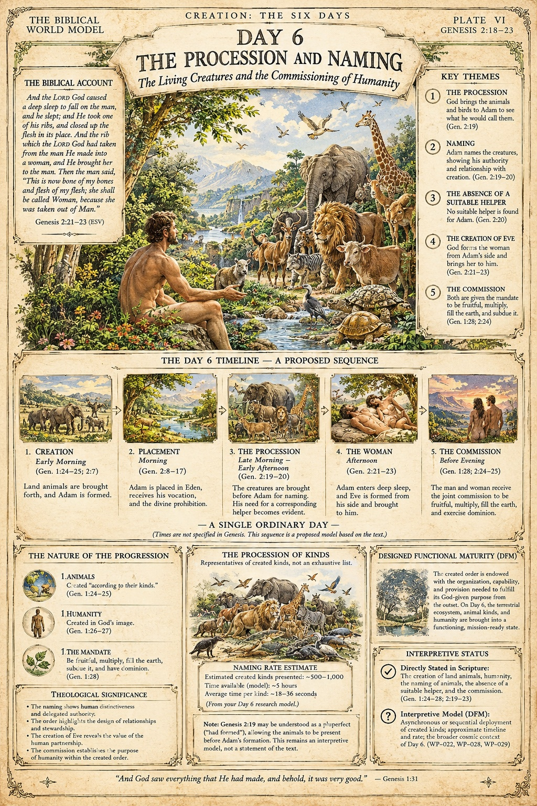

# First Concepts (Archived)

On 13 November 2026 the atlas's production restarted from the beginning: individual landscape page plates at the ruled 12 x 9 in trim, under the adopted plate style guide, with no plate numbers on the artwork. The first round of concept artwork - a cover mock, the two Spread 001 plates, and three portrait day plates, all supplied as concepts earlier the same day - was retired to this archive page and to the [repository archive](https://github.com/jdlongmire/biblical-worldmodel/tree/main/bwm-illustrated/archive/first-concepts), where each piece keeps its full front-matter record. Nothing here is current production and none of it is print-ready; it is kept openly, as the record of how the book's visual language was worked out.

Current production begins at [The Creation Day Plates](creation-day-plates.md).

## The first cover concept

*Cover concept (record [BWM-IL-000](https://github.com/jdlongmire/biblical-worldmodel/blob/main/bwm-illustrated/archive/first-concepts/000-cover.md)). A rendered book mock with the bound spine visible, not flat cover art. It named the six-term arc the atlas traces: Creation, Humanity, The Flood, Nations, Redemption, The World to Come - an arc the new cover keeps.*

## Spread 001 - Creation: The Six Days of Genesis 1

Genesis begins with God creating the heavens and the earth (Genesis 1:1). The account unfolds as a sequence of divine commands, distinctions, and provisions, and culminates in God's rest on the seventh day (Genesis 2:1-3). This spread made that sequence visible: an overview plate carrying all seven days, then a companion plate that slows down at the two days the whole structure turns on.

*Plate BWM-IL-001 - The Creation of the World (book page 24).*

The seven days: Day 1, Light (Gen. 1:3-5); Day 2, Sky / Expanse (Gen. 1:6-8); Day 3, Land and Plants (Gen. 1:9-13); Day 4, Sun, Moon and Stars (Gen. 1:14-19); Day 5, Sea Life and Birds (Gen. 1:20-23); Day 6, Land Animals and Man (Gen. 1:24-31); Day 7, Rest and Blessing (Gen. 2:1-3). Key insights, as lettered on the plate: the six days are real and sequential; the work is ordered and purposeful; the world is made with functional maturity, prepared for life and vocation; and humanity is the climax, created in the image of God (Gen. 1:26-27).

> Scripture focus: "For in six days the LORD made the heavens and the earth, the sea, and all that is in them, and rested on the seventh day." - Exodus 20:11 (ESV)

*Plate BWM-IL-002 - Day 1 and Day 4 (book page 25). The armillary device is artistic symbolism for calendrical governance, not an instrument of the creation week.*

The pairing was the point of the spread. Light is *provided* on Day 1 and its governors are *appointed* on Day 4; the sequence distinguishes the gift from the instruments later assigned to rule it. Within the Biblical WorldModel, **functional maturity** - a world created already working, rather than assembled by slow accretion - is the interpretive proposal that reads this sequence as deliberate. That proposal is labelled as interpretation in the book's editorial record, not presented as something the text states in so many words.

*Records: [BWM-IL-001](https://github.com/jdlongmire/biblical-worldmodel/blob/main/bwm-illustrated/archive/first-concepts/001-creation-of-the-world.md) and [BWM-IL-002](https://github.com/jdlongmire/biblical-worldmodel/blob/main/bwm-illustrated/archive/first-concepts/002-day-1-and-day-4.md).*

## The portrait day plates

Alongside the spread, the first round grew a second format: a stand-alone portrait plate for each day of creation, under the header *Creation: The Six Days*, each carrying the biblical account, key elements, theological significance, a Designed Functional Maturity panel, and an interpretive status panel. Three were received: Days 1, 4, and 6. Their format work - above all the discipline of labelling what Scripture states and what is model - carries into the production line; their portrait form does not.

### Plate I - Day 1: Light and Order

*Plate I (record [BWM-IL-003](https://github.com/jdlongmire/biblical-worldmodel/blob/main/bwm-illustrated/archive/first-concepts/003-day-1-light-and-order.md)) - Genesis 1:1-5.*

God is the source of the first light (Gen. 1:3); light is separated from darkness (Gen. 1:4); light is named Day and darkness Night (Gen. 1:5); and evening and morning form the first full day. Its interpretive status panel states the distinction the atlas keeps throughout: the light's creation, separation, and naming are directly stated in Scripture; the *nature* of that divine light, provided before the sun existed, is interpretive model.

> "In Him was life, and the life was the light of men." - John 1:4 (ESV)

### Plate IV - Day 4: The Heavens Appointed

*Plate IV (record [BWM-IL-004](https://github.com/jdlongmire/biblical-worldmodel/blob/main/bwm-illustrated/archive/first-concepts/004-day-4-the-heavens-appointed.md)) - Genesis 1:14-19.*

On Day 4 the sun, moon, and stars are appointed: to govern the day and the night, to be for signs, to mark seasons, days, and years, and to give light upon the earth (Gen. 1:14-17). The plate sets this beside Day 1 - divine illumination first, astronomical governance second - and then presents the Designed Functional Maturity deployment model: two temporal domains, one purpose. The plate labels that deployment model exactly as this archive does: a plausible, testable hypothesis, not a textual requirement.

> "The heavens declare the glory of God, and the sky above proclaims His handiwork." - Psalm 19:1 (ESV)

### Plate VI - Day 6: The Procession and Naming

*Plate VI (record [BWM-IL-005](https://github.com/jdlongmire/biblical-worldmodel/blob/main/bwm-illustrated/archive/first-concepts/005-day-6-the-procession-and-naming.md)) - Genesis 1:24-31; 2:7-25. This day is also the subject of the site article [Naming the Animals on the Sixth Day](../publications/articles/sixth-day-naming-model.md).*

God brings the animals and birds to Adam; Adam names them, and no suitable helper is found; God forms the woman from Adam's side and brings her to him; and both receive the commission to be fruitful, multiply, fill the earth, and subdue it (Gen. 1:28; 2:19-24). The plate lays out the day as a proposed sequence within a single ordinary day, and gives the naming model's arithmetic openly: an estimated 500-1,000 created kinds presented over about five hours, roughly 18-36 seconds per kind - a proposed model based on the text, not times the text specifies.

> "And God saw everything that He had made, and behold, it was very good." - Genesis 1:31

!!! note "Status of the archived concepts"
    All six pieces are concept prototypes at web resolution, with review gates never passed; none is print-ready, and production has restarted without them. Two filing findings stand in their records. Plate VI, as supplied, carries lettering errors in one small panel - a three-item list numbered 1, 1, 1, and two malformed words in its summary of Genesis 1:28. Plates IV and VI print the research programme's internal work-package codes in their interpretive status panels. The PLATE I, IV, and VI headers are themselves superseded by the author's ruling that plate numbers do not appear on plate artwork.
