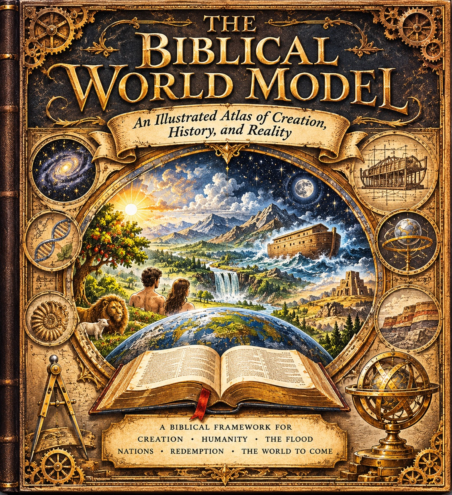

# The Illustrated Atlas

**The Biblical World Model: An Illustrated Atlas of Creation, History, and Reality**

This sub-site is the first iteration of *BWM Illustrated*, a coffee-table book in the making. Each entry of the book is a two-page illustrated spread: a large hand-coloured plate, numbered callouts, concise prose, Scripture references, and a note on what the text states, what is inferred, and what remains a proposal. The book is being built in the open, one spread at a time, and this site is where each spread is first published.

!!! note "Status - concept prototype"
    The atlas is in preproduction. The cover and the first spread are concept artwork: the wording lettered into the plates is part of the artwork, not finished typesetting, and every plate passes editorial review gates (Scripture checked, theological review, visual accuracy, print proof) before it counts as final. Statuses are stated on each spread page rather than smoothed over.

## Start reading

- [Spread 001 - Creation: The Six Days of Genesis 1](creation-six-days.md) - the overview plate and its companion: Day 1, light provided, set against Day 4, the heavenly lights appointed to govern.
- [The Creation Day Plates](creation-day-plates.md) - stand-alone plates for Days 1, 4, and 6, one plate per day, each with its own interpretive status panel. Plates for Days 2, 3, and 5 are outstanding.

## The arc of the book

The cover names the framework the atlas will trace:

- **Creation** - the world made ordered, functional, and good.
- **Humanity** - man in the image of God, placed, tasked, and fallen.
- **The Flood** - judgment and preservation in the ancient world.
- **Nations** - dispersion, peoples, and the world of Scripture.
- **Redemption** - the covenant story carried to its fulfilment.
- **The World to Come** - consummation and renewal.

## Contents so far

| Spread | Title | Book pages | State |
|---|---|---|---|
| 001 | Creation: The Six Days of Genesis 1 | 24-25 | Concept plates published here |
| Day plates | Creation: The Six Days, Plates I-VI | - | Plates I, IV, and VI published here; II, III, and V outstanding |
| 002 | The Garden of Eden | - | Editorial prototype written; plates not yet filed |
| 003 | The Flood | - | Editorial prototype written; plates not yet filed |

## From this site to the book

Nothing on this site is print-ready, and that is deliberate. The site is the workshop and the first public form; the printed book is built from print masters made afterwards: artwork without baked-in lettering, editable typesetting, and resolution matched to the final trim. The production routes and the gates each one requires are set out in [Building the Book](building-the-book.md).

The working record behind the pictures - editorial charter, creative direction, spread template, production specification, and the front-matter record for every filed plate - is kept in the open in the [biblical-worldmodel repository](https://github.com/jdlongmire/biblical-worldmodel/tree/main/bwm-illustrated), with the plate register at [illustrated-plates](https://github.com/jdlongmire/biblical-worldmodel/tree/main/bwm-illustrated/illustrated-plates).
