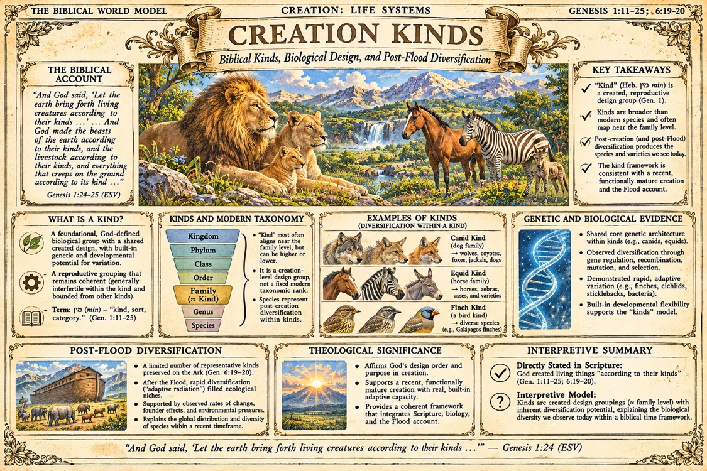

# Life Systems

Topical plates of the atlas: the created living world, its design
groupings, and its history of diversification, treated under the
same discipline as the day plates (what Scripture states, what the
data show, and what the model infers, kept distinct on the plate
itself).

## Creation Kinds

*Plate (record [BWM-IL-012](https://github.com/jdlongmire/biblical-worldmodel/blob/main/bwm-illustrated/illustrated-plates/012-creation-kinds-landscape.md)) - Genesis 1:11-25; 6:19-20.*

The first Life Systems plate, supplied by the author and filed as
supplied. It sets out the biblical "kind" (Hebrew min): a created,
reproductive design group, broader than the modern species and
often mapping near the family level, with built-in potential for
variation. Post-creation and post-Flood diversification within
kinds produces the species and varieties observed today; its
examples are the canid, equid, and finch kinds, with the genetic
and biological evidence panel alongside. Its interpretive summary
states the distinction plainly: creation "according to their
kinds" is what Scripture states (Gen. 1:11-25; 6:19-20); the kind
as a design grouping at about the family level, with inherent
diversification potential inside a biblical time framework, is
the interpretive model.

## Time Is Not a Mechanism

*Plate (record [BWM-IL-019](https://github.com/jdlongmire/biblical-worldmodel/blob/main/bwm-illustrated/illustrated-plates/019-time-is-not-a-mechanism-landscape.md)) - no Scripture reference is cited on the plate.*

The second Life Systems plate, supplied by the author and filed as
supplied. It replaces the Design vs. "Timergence" plate originally
filed under this number, at the author's direction before that
filing merged. The plate defines the author's coined term:
timergence is the critique of appeals to sufficient time, chance,
trials, complexity, emergence, or multiple universes that assume an
origin event is plausible without demonstrating causally sufficient
mechanisms. Time, the plate argues, is a dimension of sequence and
duration; by itself it does not create, organize, or generate new
information. What an origins claim needs is a causal mechanism,
shown sufficient to its outcome - the standard its three-step
evidence test applies, and its key takeaway states in one line:
possibility is not demonstration.

!!! note "Status of these plates"
    Concept candidates at web resolution, with review gates pending; not print-ready. This plate was supplied by the author and filed as supplied; its filing audit is recorded in its record.
