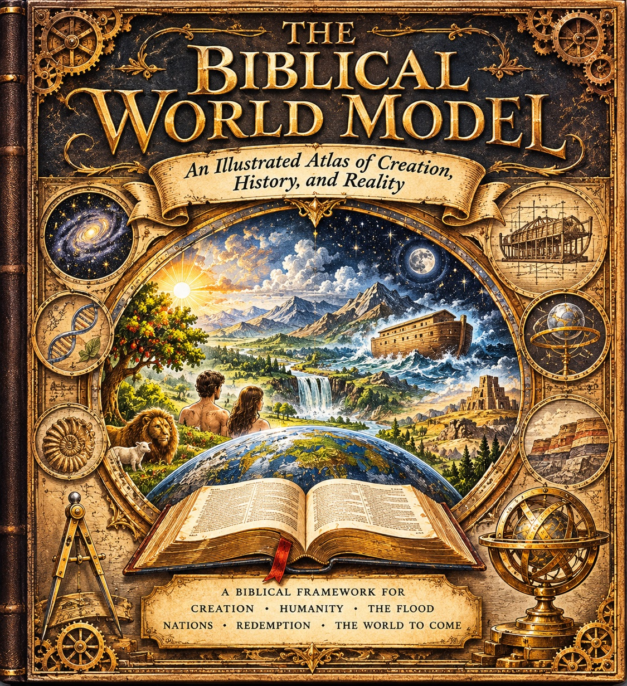

# BWM-IL-000 - Cover

**Role:** Front cover of the book, and the hero image for the first iteration of the BWM Illustrated Pages sub-site (see the site plan recorded with this filing). It is not a plate and does not belong to any spread or entry.

## What the cover shows

Gold title lettering on a dark ground: "The Biblical World Model", with the ribbon subtitle "An Illustrated Atlas of Creation, History, and Reality". A central arched scene gathers the book's scope: Eden's tree, a lion and a lamb, the first couple seen from behind, sunrise, mountains, a waterfall and river, the Ark on storm waters, moon and stars, and a stepped ancient structure, over a globe and an open Bible in the foreground. Six medallions ring the scene: a spiral galaxy, a DNA double helix, an ammonite fossil, the Ark under construction, an armillary globe, and rock strata. Gears, a divider compass, and an armillary sphere carry the inventor's-folio visual metaphor from the creative direction. The base panel reads: "A Biblical Framework for Creation - Humanity - The Flood - Nations - Redemption - The World to Come".

## Record notes

- As supplied, the image is a rendered book mock: the bound spine along the left edge is part of the supplied picture. That is unproblematic for web display exactly as supplied, and is recorded here so no later user mistakes this file for flat cover art.
- The framework line gives the book's arc in six terms - Creation, Humanity, The Flood, Nations, Redemption, The World to Come. The provisional contents in ../table-of-contents.md are organised in six parts on a different scheme (Foundations; Beginnings; The Ancient World; The World of Scripture; The Created Order; Integration and Horizons). Whether the cover's six terms become the part structure is a reconciliation for JD's ruling, recorded with the other open items in the index.
- Title and subtitle on the cover match the working title in ../README.md exactly.

Human-Curated, AI-Enabled (HCAE)
