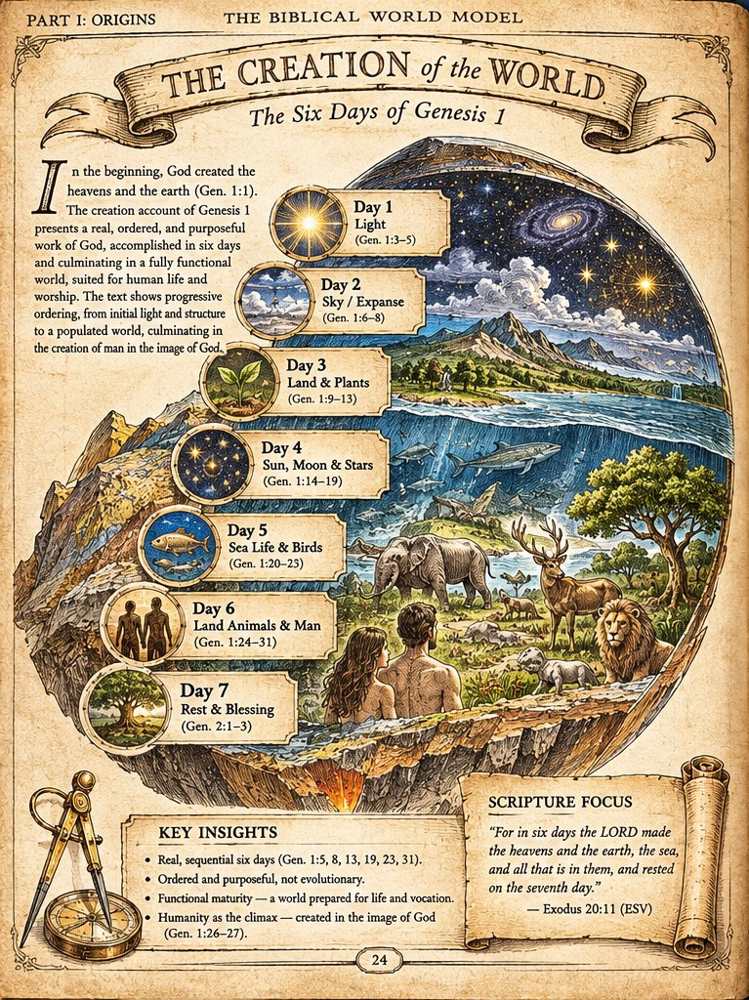

# BWM-IL-001 - The Creation of the World

**Plate role:** Overview (left) page of the Entry 001 two-page spread. Its companion is [BWM-IL-002](002-day-1-and-day-4.md), page 25.

## What the plate shows

A circular sectional panorama of the created world, ringed by seven medallions, one for each day, beneath the title ribbon "The Creation of the World - The Six Days of Genesis 1". Header as printed: "Part I: Origins / The Biblical World Model". Page number as printed: 24.

## Callout ledger (as printed)

1. Day 1 - Light (Gen. 1:3-5)
2. Day 2 - Sky / Expanse (Gen. 1:6-8)
3. Day 3 - Land and Plants (Gen. 1:9-13)
4. Day 4 - Sun, Moon and Stars (Gen. 1:14-19)
5. Day 5 - Sea Life and Birds (Gen. 1:20-23)
6. Day 6 - Land Animals and Man (Gen. 1:24-31)
7. Day 7 - Rest and Blessing (Gen. 2:1-3)

This matches the callout ledger in the Entry 001 brief, item for item.

## Text on the plate (summary)

- Orientation paragraph opening with Genesis 1:1: a real, ordered, purposeful work of God in six days, culminating in a fully functional world and in man created in the image of God.
- Key Insights: real, sequential six days; ordered and purposeful, not evolutionary; functional maturity - a world prepared for life and vocation; humanity as the climax, created in the image of God (Gen. 1:26-27).
- Scripture Focus: Exodus 20:11 (ESV), quoted on a scroll at lower right.

## Record notes

- Part name conflict to reconcile: the plate reads "Part I: Origins"; the provisional contents in ../table-of-contents.md place the six days under "Part II: Beginnings" and use "Part I: Foundations" for a different section. This record keeps both, as printed and as filed, until JD rules.
- Orientation conflict to note: the plate is portrait; the creative direction and production specification currently describe a landscape or near-square trim. Recorded, not resolved.
- Embedded text is artwork, not verified typesetting. Per the spread template gates, ESV wording, references, and every printed claim must be checked before this plate's status can advance, and a print version must be rebuilt with editable text at production resolution.

Human-Curated, AI-Enabled (HCAE)
