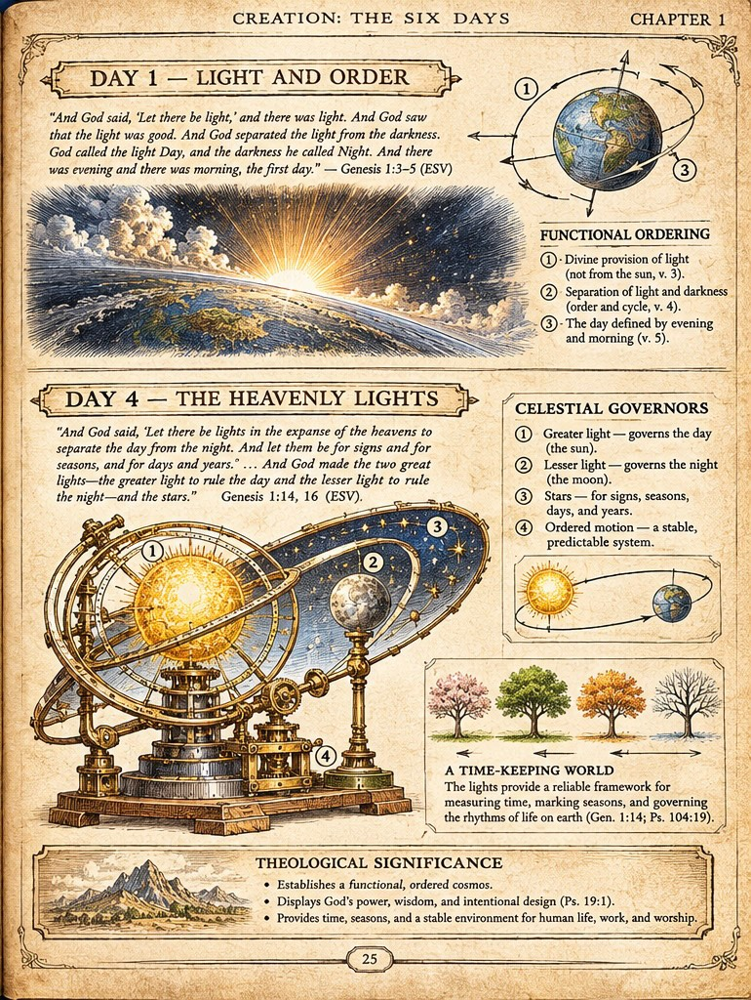

# BWM-IL-002 - Day 1: Light and Order / Day 4: The Heavenly Lights

**Plate role:** Companion detail (right) page of the Entry 001 two-page spread. Its companion is [BWM-IL-001](001-creation-of-the-world.md), page 24.

## What the plate shows

Two stacked panels under the header "Creation: The Six Days / Chapter 1". Page number as printed: 25.

Upper panel, **Day 1 - Light and Order:** sunrise over the earth's horizon, a schematic globe with numbered orbit lines, and a "Functional Ordering" list:

1. Divine provision of light (not from the sun, v. 3).
2. Separation of light and darkness (order and cycle, v. 4).
3. The day defined by evening and morning (v. 5).

Quoted text: Genesis 1:3-5 (ESV).

Lower panel, **Day 4 - The Heavenly Lights:** an armillary-style mechanism bearing the sun and moon, a "Celestial Governors" list, a sun-earth orbit inset, and a four-seasons tree strip captioned "A Time-Keeping World":

1. Greater light - governs the day (the sun).
2. Lesser light - governs the night (the moon).
3. Stars - for signs, seasons, days, and years.
4. Ordered motion - a stable, predictable system.

Quoted text: Genesis 1:14, 16 (ESV, excerpted with ellipses on the plate).

Footer, **Theological Significance:** establishes a functional, ordered cosmos; displays God's power, wisdom, and intentional design (Ps. 19:1); provides time, seasons, and a stable environment for human life, work, and worship.

## Record notes

- The Day 1 / Day 4 contrast is deliberate, not a pagination error: the Entry 001 brief specifies exactly this pairing, to show light provided before the luminaries are appointed as its governors.
- The armillary mechanism is a conceptual visual metaphor, per the Entry 001 brief and the creative direction (steampunk as visual metaphor, not a historical claim). Any print caption must say so.
- Chapter scheme to reconcile: the plate header reads "Chapter 1"; the provisional contents in ../table-of-contents.md are organised by parts only. Recorded as printed until JD rules.
- Embedded text is artwork, not verified typesetting. ESV wording - including the excerpted Day 4 quotation - references, and every printed claim must pass the spread template gates before this plate's status can advance.

Human-Curated, AI-Enabled (HCAE)
