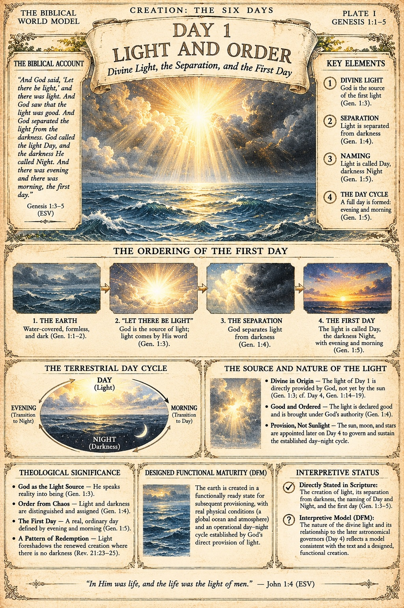

# BWM-IL-003 - Day 1: Light and Order (Plate I)

**Plate role:** First of a day-plate sub-series, "Creation: The Six Days", one plate per creation day. It is not a page of Spread 001 (BWM-IL-001 / 002); it expands Day 1, which the spread's companion plate treats in summary. Plates II, III, and V of the sub-series had not been supplied when this record was filed.

## What the plate shows

Header: "Creation: The Six Days / Plate I / Genesis 1:1-5". Title: "Day 1 - Light and Order: Divine Light, the Separation, and the First Day". A central seascape under divine light breaking through cloud over the waters.

- **The Biblical Account:** Genesis 1:3-5 (ESV), quoted in full.
- **Key Elements:** (1) Divine Light - God is the source of the first light (Gen. 1:3); (2) Separation - light separated from darkness (Gen. 1:4); (3) Naming - light called Day, darkness Night (Gen. 1:5); (4) The Day Cycle - evening and morning form a full day (Gen. 1:5).
- **The Ordering of the First Day:** a four-step strip - the earth (water-covered, formless, dark; Gen. 1:1-2); "Let there be light" (Gen. 1:3); the separation (Gen. 1:4); the first day (Gen. 1:5).
- **The Terrestrial Day Cycle:** an oval cycle diagram - Day (light), Evening (transition to night), Night (darkness), Morning (transition to day).
- **The Source and Nature of the Light:** divine in origin, not yet the sun (Gen. 1:3; cf. Day 4, Gen. 1:14-19); good and ordered; provision, not sunlight - the sun, moon, and stars are appointed later, on Day 4, to govern and sustain the established cycle.
- **Theological Significance:** God as the light source; order from chaos (Gen. 1:4); the first day as a real, ordinary day (Gen. 1:5); a pattern of redemption - light foreshadows the renewed creation where there is no darkness (Rev. 21:23-25).
- **Designed Functional Maturity (DFM):** the earth created in a functionally ready state, with real physical conditions and an operational day-night cycle established by God's direct provision of light.
- **Interpretive Status:** as summarised in the front matter above - the plate labels its own claims.
- **Footer:** "In Him was life, and the life was the light of men." - John 1:4 (ESV)

## Record notes

- The day plates are a second format alongside the Spread 001 pages: portrait 2:3 at 1024 x 1536, each carrying a biblical account, key elements, theological significance, a DFM panel, and an explicit interpretive status panel. The format strengthens the claim-class discipline the spread template requires; the plates label model content as model content themselves.
- No book page is printed on the day plates; pagination for this sub-series is undecided and is not inferred here.
- **Plate numbering (JD ruling, 2026-11-13):** plate numbers are not to appear on the plate artwork. This plate as supplied prints "PLATE I" in its header; a corrected plate is to omit it. The numeral is retained in this record and the register for identification only.

Human-Curated, AI-Enabled (HCAE)
