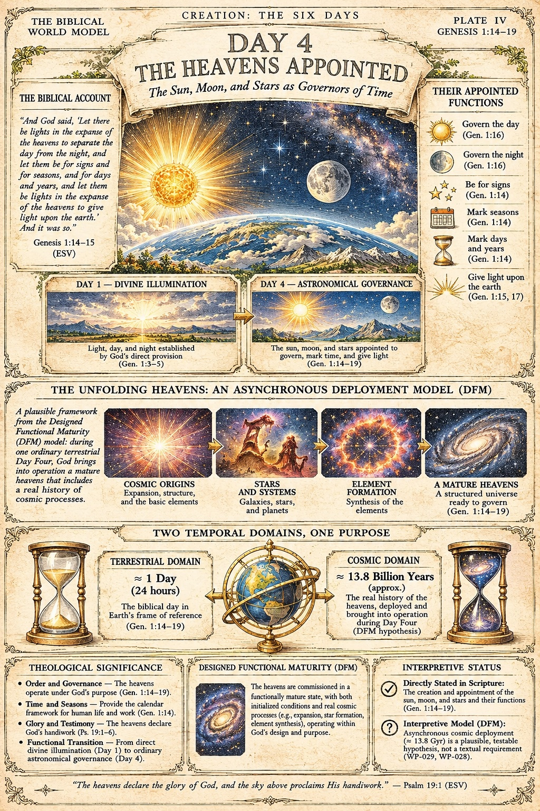

# BWM-IL-004 - Day 4: The Heavens Appointed (Plate IV)

**Plate role:** Fourth plate of the day-plate sub-series, "Creation: The Six Days" (see BWM-IL-003). It expands Day 4, the appointment of the heavenly lights, which Spread 001's companion plate (BWM-IL-002) treats in summary.

## What the plate shows

Header: "Creation: The Six Days / Plate IV / Genesis 1:14-19". Title: "Day 4 - The Heavens Appointed: The Sun, Moon, and Stars as Governors of Time". Central scene: the sun and moon over a curved, mountainous earth under a star field.

- **The Biblical Account:** Genesis 1:14-15 (ESV), quoted.
- **Their Appointed Functions:** govern the day (Gen. 1:16); govern the night (Gen. 1:16); be for signs (Gen. 1:14); mark seasons (Gen. 1:14); mark days and years (Gen. 1:14); give light upon the earth (Gen. 1:15, 17).
- **Transition panels:** Day 1 - Divine Illumination (light, day, and night established by God's direct provision, Gen. 1:3-5) gives way to Day 4 - Astronomical Governance (the sun, moon, and stars appointed to govern, mark time, and give light, Gen. 1:14-19).
- **The Unfolding Heavens - an Asynchronous Deployment Model (DFM):** a four-step strip - Cosmic Origins (expansion, structure, basic elements); Stars and Systems (galaxies, stars, planets); Element Formation (synthesis of the elements); A Mature Heavens (a structured universe ready to govern, Gen. 1:14-19).
- **Two Temporal Domains, One Purpose:** terrestrial domain, approx. 1 day (24 hours), the biblical day in earth's frame of reference (Gen. 1:14-19); cosmic domain, approx. 13.8 billion years, the real history of the heavens, deployed and brought into operation during Day Four (marked on the plate as a DFM hypothesis).
- **Theological Significance:** order and governance (Gen. 1:14-19); time and seasons as the calendar framework for human life and work (Gen. 1:14); glory and testimony (Ps. 19:1-6); the functional transition from direct divine illumination (Day 1) to ordinary astronomical governance (Day 4).
- **Designed Functional Maturity (DFM):** the heavens commissioned in a functionally mature state, with initialized conditions and real cosmic processes operating within God's design and purpose.
- **Interpretive Status:** as summarised in the front matter above.
- **Footer:** "The heavens declare the glory of God, and the sky above proclaims His handiwork." - Psalm 19:1 (ESV)

## Record notes

- **Internal references printed on the plate:** the Interpretive Status panel cites "(WP-029, WP-028)" - programme work-package codes a general reader cannot resolve from the plate. Recorded as an editorial decision for JD: retain as a traceability pointer, expand to plain language, or move to the companion record when the plate is rebuilt for print. The plate is filed exactly as supplied; nothing on it has been altered.
- The approx. 13.8 billion year figure belongs to the DFM hypothesis panel, not to the biblical account panel; the site page for these plates presents it under the same label the plate itself uses.
- **Plate numbering (JD ruling, 2026-11-13):** plate numbers are not to appear on the plate artwork. This plate as supplied prints "PLATE IV" in its header; a corrected plate is to omit it. The numeral is retained in this record and the register for identification only.

Human-Curated, AI-Enabled (HCAE)
