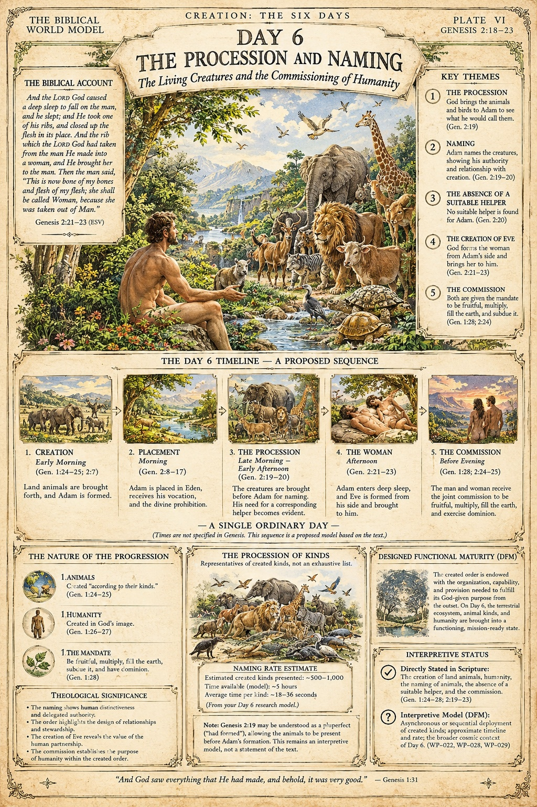

# BWM-IL-005 - Day 6: The Procession and Naming (Plate VI)

**Plate role:** Sixth plate of the day-plate sub-series, "Creation: The Six Days" (see BWM-IL-003). Day 6 is also the subject of the site article "Naming the Animals on the Sixth Day"; this plate presents that research model in illustrated form.

## What the plate shows

Header: "Creation: The Six Days / Plate VI / Genesis 2:18-23" (the plate's content ranges wider: Genesis 1:24 to 2:25, as the citations below show). Title: "Day 6 - The Procession and Naming: The Living Creatures and the Commissioning of Humanity". Central scene: Adam seated in Eden as the animals process past, Eve not yet formed.

- **The Biblical Account:** Genesis 2:21-23 (ESV), quoted - the deep sleep, the rib, the woman brought to the man, and Adam's words.
- **Key Themes:** (1) The Procession - God brings the animals and birds to Adam (Gen. 2:19); (2) Naming - Adam names the creatures, showing authority and relationship (Gen. 2:19-20); (3) The Absence of a Suitable Helper (Gen. 2:20); (4) The Creation of Eve - God forms the woman from Adam's side and brings her to him (Gen. 2:21-23); (5) The Commission - fruitful, multiply, fill the earth, subdue it (Gen. 1:28; 2:24).
- **The Day 6 Timeline - A Proposed Sequence:** Creation (early morning; Gen. 1:24-25; 2:7); Placement (morning; Gen. 2:8-17); The Procession (late morning to early afternoon; Gen. 2:19-20); The Woman (afternoon; Gen. 2:21-23); The Commission (before evening; Gen. 1:28; 2:24-25). Headed "A Single Ordinary Day", with the plate's own note that times are not specified in Genesis and the sequence is a proposed model.
- **The Procession of Kinds:** representatives of created kinds, not an exhaustive list. Naming-rate estimate from the Day 6 research model: an estimated 500-1,000 created kinds presented over about 5 hours, an average of roughly 18-36 seconds per kind. A note adds that Genesis 2:19 may be understood as a pluperfect ("had formed"), an interpretive model, not a statement of the text.
- **Theological Significance:** the naming shows human distinctiveness and delegated authority; the order highlights designed relationships and stewardship; the creation of Eve reveals the value of the human partnership; the commission establishes humanity's purpose within the created order.
- **Designed Functional Maturity (DFM):** the created order endowed from the outset with the organisation, capability, and provision its God-given purpose requires; on Day 6 the terrestrial ecosystem, animal kinds, and humanity are brought into a functioning, mission-ready state.
- **Interpretive Status:** as summarised in the front matter above.
- **Footer:** "And God saw everything that He had made, and behold, it was very good." - Genesis 1:31 (no version tag printed on this footer; Plates I and IV tag theirs ESV).

## Record notes

- **Lettering defects:** see qa_findings. They sit in a small summary panel and do not affect the plate's account, themes, or timeline; they do bar the plate from any final or print status until repaired, and the sub-site page discloses them in its status note.
- **Internal references printed on the plate:** the Interpretive Status panel cites "(WP-022, WP-028, WP-029)". Same editorial decision as BWM-IL-004, recorded there; the two plates should be treated alike when rebuilt.
- **Header citation vs range:** the header cites Genesis 2:18-23, the naming account; the plate as a whole treats Genesis 1:24 to 2:25. Recorded as printed.

Human-Curated, AI-Enabled (HCAE)
