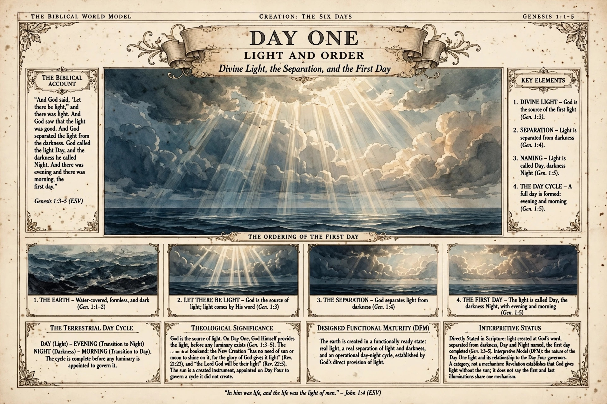

# BWM-IL-006 - Day 1: Light and Order (landscape candidate)

**Plate role:** The first candidate plate produced under the adopted plate style guide and the ruled landscape format: an individual landscape page plate for Day 1 of "Creation: The Six Days". It is a candidate recomposition of the Day 1 subject alongside the supplied portrait concept BWM-IL-003, which remains the filed concept of the supplied day-plate set; this candidate does not replace it. It was filed as a candidate at JD's direction and is held for his disposition.

## What the plate shows

Header: "The Biblical World Model / Creation: The Six Days / Genesis 1:1-5" - no plate number, by design. Title: "Day One - Light and Order: Divine Light, the Separation, and the First Day". A central seascape: divine light breaking through cloud over the waters, with no sun, moon, or stars anywhere in the scene.

- **The Biblical Account:** Genesis 1:3-5 (ESV), quoted in full.
- **Key Elements:** (1) Divine Light - God is the source of the first light (Gen. 1:3); (2) Separation - light separated from darkness (Gen. 1:4); (3) Naming - light called Day, darkness Night (Gen. 1:5); (4) The Day Cycle - evening and morning form a full day (Gen. 1:5).
- **The Ordering of the First Day:** a four-step strip - the earth (water-covered, formless, and dark; Gen. 1:1-2); "Let there be light" - God is the source of light (Gen. 1:3); the separation (Gen. 1:4); the first day (Gen. 1:5).
- **The Terrestrial Day Cycle:** Day (light), Evening (transition to night), Night (darkness), Morning (transition to day) - the cycle complete before any luminary is appointed to govern it.
- **Theological Significance:** God is the source of light: on Day One God Himself provides the light, before any luminary exists (Gen. 1:3-5); the canonical bookend of the New Creation, which "has no need of sun or moon to shine on it, for the glory of God gives it light" (Rev. 21:23) and where "the Lord God will be their light" (Rev. 22:5); the sun as a created instrument, appointed on Day Four to govern a cycle it did not create. The framing follows JD's published initialization article on the atlas site.
- **Designed Functional Maturity (DFM):** the earth created in a functionally ready state - real light, a real separation, and an operational day-night cycle, established by God's direct provision of light.
- **Interpretive Status:** as summarised in the front matter above, including the plate's own guardrail: Revelation establishes that God gives light without the sun; it does not say the first and last illuminations share one mechanism.
- **Footer:** "In him was life, and the life was the light of men." - John 1:4 (ESV)

## Record notes

- **Repair disclosure (2026-11-13):** the raw generation printed "canorical" for "canonical" in the theological significance compartment. At JD's direction the single word was repaired in place programmatically: the word was erased and reset in a matched serif bold face at the original width and baseline, using pixel-map measurement of the surrounding glyphs. The repair was verified by magnified crop readback and by a pixel comparison confirming zero change outside the patched word's box. The unrepaired generation is retained outside the repository; its SHA-256 is recorded in the provenance field above. Two earlier patch attempts failed verification and were discarded; only the verified repair is filed here.
- **Format:** landscape is the ruled production format; this candidate's 3:2 generation aspect still differs from the trim's 4:3 and its resolution is concept-grade, so it stands as a composition and content candidate, not a production master.
- **Relation to BWM-IL-003:** same day, same subject, different format line. The supplied portrait plate and this generated landscape candidate coexist until JD rules on the landscape production set.

Human-Curated, AI-Enabled (HCAE)
