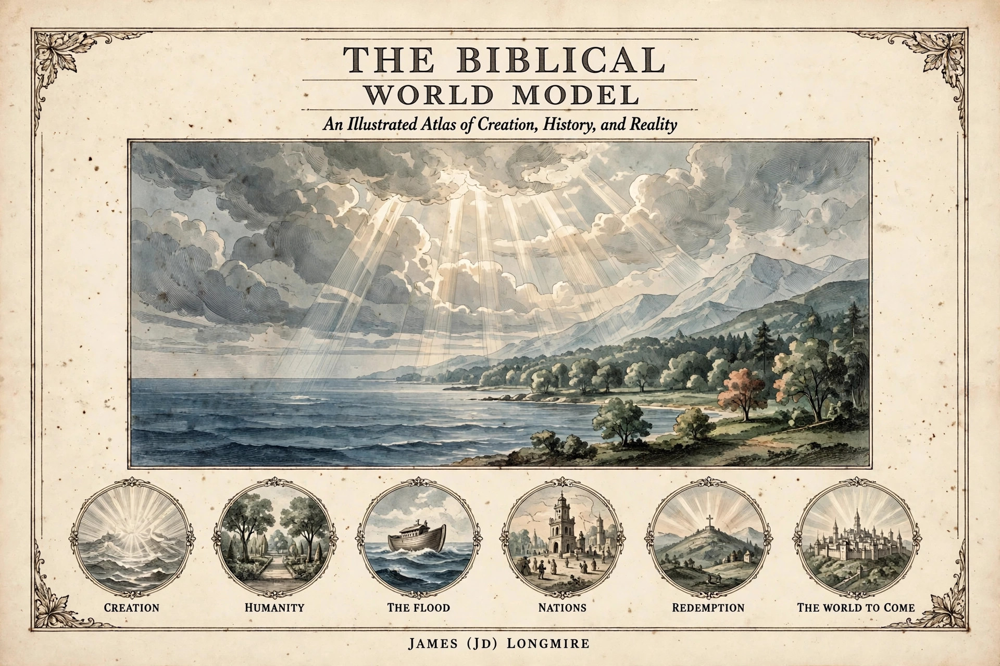

# BWM-IL-007 - Cover (landscape)

**Cover role:** The front cover of the restarted production: the first filing after the 2026-11-13 restart, replacing the archived first cover concept (BWM-IL-000, a rendered book mock) with flat landscape cover art in the adopted style, benchmarked against BWM-IL-006.

## What the cover shows

- **Title:** "The Biblical World Model", display capitals, with the subtitle "An Illustrated Atlas of Creation, History, and Reality" in italic beneath.
- **Central artwork:** a creation panorama in the plate style - divine light breaking through cloud over a vast sea, a green ordered shore with trees and distant mountains; no sun disc, no moon, no human figures.
- **The arc medallions:** six engraved medallions in a row - Creation (light over the waters), Humanity (a garden), The Flood (the ark on waves), Nations (a tower with scattered peoples), Redemption (a cross on a hill), The World to Come (a radiant city) - each labelled beneath.
- **Author line:** "James (JD) Longmire", set below the frame's lower border.

## Record notes

- The six-term arc is carried over from the archived first cover by design: it is the framework the atlas traces, and the restarted contents will be built against it.
- As with every plate of the new line, this is a concept candidate: gates pending, and a print master remains a separate recomposition at trim size with typeset lettering.

Human-Curated, AI-Enabled (HCAE)
