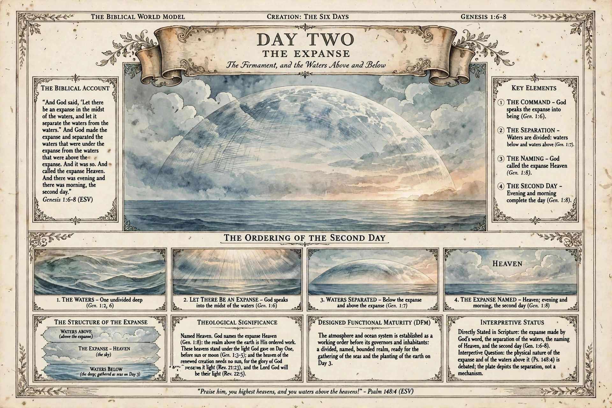

# BWM-IL-008 - Day 2: The Expanse (landscape)

**Production role:** The Day Two plate of the restarted production line, following the cover (BWM-IL-007) and Day One (BWM-IL-006, the style benchmark).

## What the plate carries

- **The Biblical Account:** Genesis 1:6-8 (ESV) in full.
- **Key Elements:** the command; the separation of the waters; the naming of the expanse as Heaven; the second day.
- **The Ordering of the Second Day:** the waters; the command spoken; the waters separated; the expanse named.
- **The Structure of the Expanse:** waters above / the expanse, Heaven / waters below (the deep; gathered as seas on Day 3).
- **Theological Significance:** the expanse named Heaven, God's ordered work; the heavens standing under the light God gave on Day One, before sun or moon; the heaven of the renewed creation needing no sun, for the glory of God gives it light (Rev. 21:23), and the Lord God will be their light (Rev. 22:5).
- **Designed Functional Maturity (DFM):** the atmosphere and ocean system established as a working order before its governors and inhabitants.
- **Interpretive Status:** what Genesis states directly, and what remains an interpretive question (the physical nature of the expanse and of the waters above it), labelled as such on the plate.
- **Footer:** "Praise him, you highest heavens, and you waters above the heavens!" - Psalm 148:4 (ESV).

## Record notes

- The plate number appears nowhere on the artwork, per the 2026-11-13 ruling; numbering is carried by this record, the register, and site captions.
- The plate's one repaired word is disclosed in full under print status above; the unrepaired generation is preserved in the session workspace for comparison.
- Earlier Day Two attempts (v1 to v5) remain unfiled session work; this is the first Day Two plate of record.

Human-Curated, AI-Enabled (HCAE)
